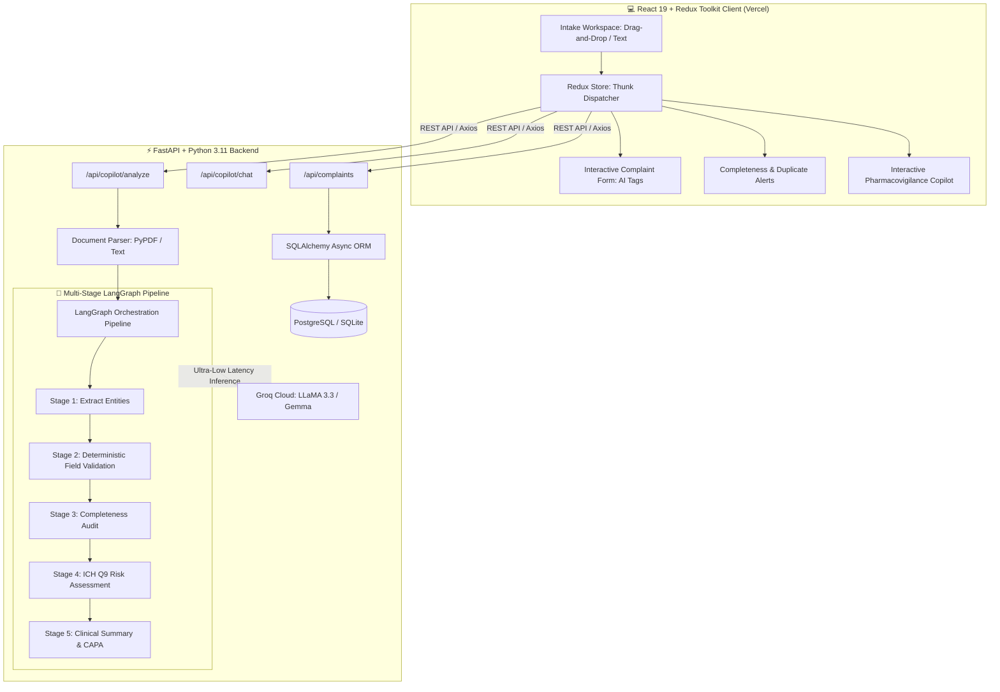

<div align="center">

# 🛡️ PharmaShield AI
### Autonomous Pharmacovigilance & Pharmaceutical Complaint Intelligence Platform

[](https://vercel.com/new/clone?repository-url=https%3A%2F%2Fgithub.com%2Froraks24%2Fpharmashield-ai&root-directory=frontend)
[](https://fastapi.tiangolo.com)
[](https://langchain-ai.github.io/langgraph/)
[](https://groq.com/)
[](https://react.dev/)
[](https://tailwindcss.com/)
[](https://www.postgresql.org/)
[](LICENSE)

<br />

**Intelligent, compliant, and autonomous customer complaint lifecycle management for pharmaceutical manufacturing and quality assurance.**

[🚀 Deploy to Vercel](#-deploying-to-vercel) · [🏗️ Architecture & Workflow](#-system-architecture) · [⚡ Quick Start](#-quick-start-local-development) · [📑 API Reference](#-api-endpoints)

</div>

---

## 🌟 Executive Overview

In Good Manufacturing Practice (GMP) pharmaceutical manufacturing, customer complaint intake, triage, and investigation are strictly regulated under **FDA 21 CFR Part 211.198** and **EU GMP Chapter 8**. Traditional workflows rely on manual email triage, delayed data entry, and inconsistent risk classification.

**PharmaShield AI** transforms this process through an autonomous multi-stage agentic pipeline:
- 📄 **Multimodal Intake**: Ingests unstructured emails, scanned batch reports, defect narratives, PDF lab documents, or raw text.
- 🧬 **Deterministic + LLM Entity Extraction**: Automatically extracts 15+ GMP-critical fields (Customer, Product Name, Strength/Dosage, Batch/Lot Number, Expiry, Adverse Reactions, Defect Nature).
- ⚖️ **Risk & Triage Engine**: Computes risk levels (`CRITICAL`, `HIGH`, `MEDIUM`, `LOW`) aligned with ICH Q9 Quality Risk Management principles.
- 🔍 **Root Cause & CAPA Hypotheses**: Suggests root-cause pathways and actionable Corrective and Preventive Actions (CAPA).
- 📊 **Completeness Audit & Duplicate Detection**: Assesses regulatory data completeness (%) and alerts QA managers to recurring batch incidents.
- 🧑‍🔬 **Human-in-the-Loop Workspace**: Highlights AI-extracted data with visual sparkle indicators, preserving manual override capabilities.
- 💬 **Conversational Pharmacovigilance Copilot**: In-app AI agent that answers SOP inquiries, updates form fields in real-time, and assists with investigation narratives.

---

## 🏗️ System Architecture



---

## 🚀 Key Functional Modules

### 1. Multi-Stage LangGraph Extraction Workflow
A stateful directed graph executes sequential quality validation:
1. **Extraction Node**: Prompts Groq with a strict schema to isolate drug name, batch numbers, manufacturer codes, and reported defect descriptions.
2. **Validation Node**: Validates date formats, batch number regex patterns, and standardizes complaint categories.
3. **Completeness Node**: Evaluates required regulatory fields, computing an audit score (0–100%) and highlighting missing fields.
4. **Risk & CAPA Node**: Analyzes patient hazard, contamination potential, sterility failure risks, and proposes immediate containment actions.
5. **Summarization Node**: Generates an executive summary suitable for inclusion in regulatory deviation logs.

### 2. Modern Clinical Theme & Human-in-the-Loop UI
Built with a sleek, clinical **Medical Emerald & Slate** design system:
- **AI-Extracted Indicators**: Fields populated by AI carry an active `✦ AI Extracted` badge with custom highlight shading.
- **Dirty Field Tracking**: Once a QA specialist edits a field, the AI badge transitions to manual override state, ensuring total traceability.
- **Duplicate Batch Detector**: Warns if the same batch or customer reported similar incidents within recent production runs.

---

## 🌐 Deploying to Vercel

### Option 1: 1-Click Vercel Deploy (Recommended)
Click the button below to deploy the frontend web client directly to Vercel:

[](https://vercel.com/new/clone?repository-url=https%3A%2F%2Fgithub.com%2Froraks24%2Fpharmashield-ai&root-directory=frontend)

1. Connect your GitHub account and import the repository.
2. In **Root Directory**, specify `frontend` (or leave default if using the root `vercel.json`).
3. Under **Environment Variables**, set:
   - `VITE_API_URL`: Your hosted backend URL (e.g., Render, Railway, or VPS).
4. Click **Deploy**.

### Option 2: Deploy via Vercel CLI
```bash
cd frontend
npx vercel
```

---

## ⚡ Quick Start (Local Development)

### Prerequisites
- **Node.js** (v18+)
- **Python** (3.10+)
- **Groq API Key** ([console.groq.com](https://console.groq.com))

---

### 1. Backend Setup (FastAPI + LangGraph)

```bash
# Navigate to backend directory
cd backend

# Create & activate virtual environment
python -m venv venv
venv\Scripts\activate      # Windows
# source venv/bin/activate # macOS / Linux

# Install dependencies
pip install -r requirements.txt

# Configure environment variables
cp .env.example .env
```

Edit `backend/.env`:
```env
GROQ_API_KEY=gsk_your_groq_api_key_here
MODEL_NAME=gemma2-9b-it
DATABASE_URL=sqlite:///./complaints.db
```

Start the FastAPI backend:
```bash
python main.py
```
> API will be running at **http://127.0.0.1:8000**  
> Interactive OpenAPI documentation available at **http://127.0.0.1:8000/docs**

---

### 2. Frontend Setup (React 19 + Vite + Tailwind v4)

```bash
# In a new terminal, navigate to frontend
cd frontend

# Install dependencies
npm install

# Start development server
npm run dev
```
> Frontend client will launch at **http://localhost:5173**

---

## 📡 API Endpoints

### AI Copilot & Analysis
| Method | Endpoint | Description |
|---|---|---|
| `POST` | `/api/copilot/analyze` | Parse document/text through LangGraph pipeline & extract structured complaint |
| `POST` | `/api/copilot/message` | Conversational agent for field updates, QA SOP guidance, and CAPA advice |

### Complaints Registry (CRUD)
| Method | Endpoint | Description |
|---|---|---|
| `GET` | `/api/complaints` | Retrieve paginated complaint records with search/filter |
| `POST` | `/api/complaints` | Create and store a new complaint with full analysis snapshot |
| `GET` | `/api/complaints/{id}` | Fetch full details, history, and AI assessment of a complaint |
| `PUT` | `/api/complaints/{id}` | Update complaint status, severity, or corrective actions |
| `DELETE` | `/api/complaints/{id}` | Archive or remove complaint record |

### System Health
| Method | Endpoint | Description |
|---|---|---|
| `GET` | `/health` | Health check endpoint returning service state and version |

---

## 📂 Project Structure

```
pharmashield-ai/
├── frontend/                     # React 19 + Redux Toolkit Web App
│   ├── src/
│   │   ├── components/
│   │   │   ├── assistant/        # CopilotChat, FileUpload, RiskAssessment, Completeness
│   │   │   ├── common/           # FormField (AI indicator), Badges, Spinners
│   │   │   ├── complaint/        # Human-in-the-Loop Complaint Form Sections
│   │   │   ├── complaints/       # Complaints Registry, Detail View, Filterable List
│   │   │   └── Navbar.jsx        # Clinical Navigation Header
│   │   ├── store/                # Redux Slices (complaint, analysis, copilot)
│   │   ├── services/api.js       # Axios client with environment base URL
│   │   └── index.css             # Tailwind v4 clinical theme definition
│   ├── package.json
│   ├── vercel.json               # Frontend Vercel configuration
│   └── vite.config.js
├── backend/                      # FastAPI Python Application
│   ├── graph/                    # LangGraph multi-stage state graph & nodes
│   ├── models/                   # Pydantic schemas & SQLAlchemy ORM models
│   ├── routes/                   # Complaint & Copilot REST routers
│   ├── services/                 # Document parsing, LLM wrappers, CRUD services
│   ├── database.py               # Async database connection engine
│   ├── config.py                 # Settings & environment configuration
│   └── main.py                   # FastAPI server entrypoint
├── vercel.json                   # Root monorepo deployment configuration
└── README.md                     # Documentation
```

---

## 📜 Compliance & Regulatory Standards

Designed to facilitate compliance with global Quality Management System (QMS) principles:
- **FDA 21 CFR Part 211.198**: Complaint files and procedures.
- **ICH Q9 (R1)**: Quality Risk Management methodologies.
- **ICH Q10**: Pharmaceutical Quality System lifecycles.
- **EU Guidelines for GMP**: EudraLex Volume 4, Chapter 8 (Complaints and Product Recall).

---

## 👤 Author

Developed by **[roraks24](https://github.com/roraks24)**.
